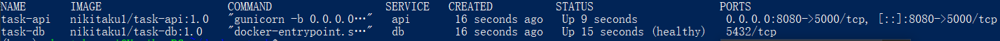
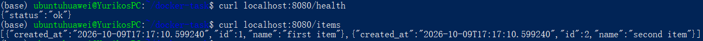
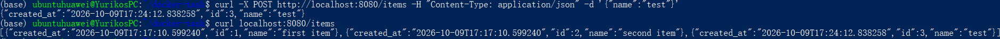
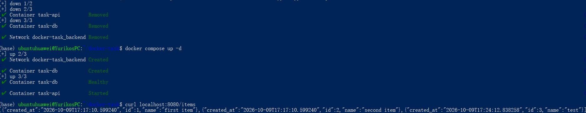
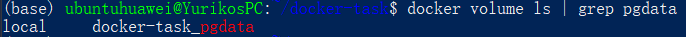
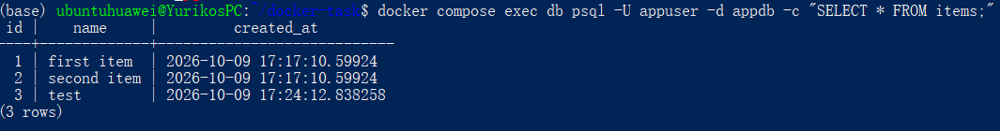
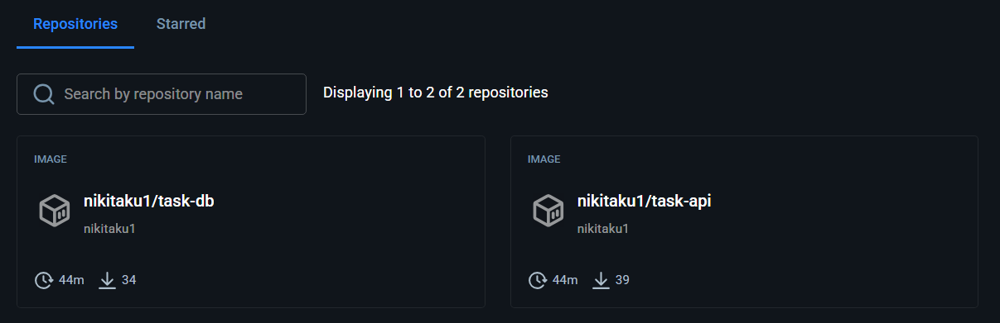

# Отчёт: Основы контейнеризации (Docker)

## 1. Задание

Настроить сеть из двух Docker-контейнеров:

- в первом размещается база данных;
- второй является точкой входа (entry point).

Необходимо продемонстрировать запрос данных из БД через точку входа. Данные в БД не должны исчезать при перезапуске контейнеров.

**Definition of Done:** репозиторий GitHub с Dockerfile для обоих контейнеров, `docker-compose.yml` для всей системы, README со списком команд для запуска и тестирования, ссылка на Docker Hub.

## 2. Архитектура решения

```
 клиент (curl)
      │  http://localhost:8080
      ▼
┌───────────────┐   сеть backend   ┌─────────────────┐
│  task-api     │ ───────────────► │  task-db        │
│  Flask +      │   db:5432        │  PostgreSQL 16  │
│  gunicorn     │                  │                 │
│  (порт 5000)  │                  │  порт наружу    │
└───────────────┘                  │  не открыт      │
                                   └────────┬────────┘
                                            │
                                   named volume `pgdata`
                                   (/var/lib/postgresql/data)
```

| Контейнер | Образ | Роль |
|---|---|---|
| `task-db` | `nikitaku1/task-db:1.0` (на базе `postgres:16-alpine`) | база данных |
| `task-api` | `nikitaku1/task-api:1.0` (на базе `python:3.12-slim`) | точка входа |

### Принятые решения

- **PostgreSQL вместо SQLite.** SQLite это встраиваемая библиотека, а не сервер. Отдельный контейнер с БД и сетевое взаимодействие между контейнерами логичнее реализовать на серверной СУБД.
- **Сохранность данных.** Данные хранятся в именованном томе `pgdata`, который управляется Docker и не удаляется при `docker compose down` (без флага `-v`).
- **Изоляция БД.** У контейнера `db` нет проброса портов на хост, обращаться к нему можно только из внутренней сети `backend` через API.
- **Порядок запуска.** У `db` настроен `healthcheck` (`pg_isready`), `api` стартует только после статуса `healthy` (`depends_on: condition: service_healthy`). Дополнительно API делает повторные попытки подключения к БД.
- **Секреты.** Параметры БД вынесены в файл `.env`, который не попадает в репозиторий (`.gitignore`). В репозитории лежит шаблон `.env.example`.
- **Инициализация БД.** Скрипт `init.sql` создаёт таблицу `items` и две начальные записи при первом запуске на пустом томе.

## 3. Структура репозитория

```
spbu_cloud/docker-task/
├── api/
│   ├── Dockerfile
│   ├── app.py
│   └── requirements.txt
├── db/
│   ├── Dockerfile
│   └── init.sql
├── screenshots/
├── .env.example
├── .gitignore
├── docker-compose.yml
├── README.md
└── REPORT.md
```

## 4. API точки входа

| Метод | Путь | Описание |
|---|---|---|
| GET | `/health` | проверка живости API и соединения с БД |
| GET | `/items` | получить все записи из таблицы `items` |
| POST | `/items` | добавить запись, тело: `{"name": "..."}` |

## 5. Ход работы и результаты

Работа выполнялась в Ubuntu под WSL2 с Docker.

### 5.1. Запуск системы

```bash
cp .env.example .env
docker compose up -d --build
docker compose ps
```

Результат: оба контейнера запущены, `task-db` в статусе `healthy`, у `task-api` проброшен порт `8080->5000`, у `task-db` виден только внутренний порт `5432/tcp`.



### 5.2. Запрос данных из БД через точку входа

```bash
curl http://localhost:8080/health
curl http://localhost:8080/items
```

Результат: API отвечает `{"status":"ok"}` и возвращает записи, прочитанные из PostgreSQL.



### 5.3. Добавление данных

```bash
curl -X POST http://localhost:8080/items \
     -H "Content-Type: application/json" \
     -d '{"name": "test"}'
curl http://localhost:8080/items
```

Результат: запись создана (HTTP 201) и появилась в общем списке.



### 5.4. Проверка сохранности данных

```bash
docker compose restart
curl http://localhost:8080/items

docker compose down 
docker compose up -d
curl http://localhost:8080/items
docker volume ls | grep pgdata
```

Результат: после перезапуска и после полного удаления и повторного создания контейнеров запись `test` на месте, том `pgdata` существует.





### 5.5. Прямая проверка таблицы в БД

```bash
docker compose exec db psql -U appuser -d appdb -c "SELECT * FROM items;"
```

Результат: содержимое таблицы в самой БД совпадает с ответом API.



### 5.6. Публикация образов на Docker Hub

Образы:

- https://hub.docker.com/r/nikitaku1/task-api
- https://hub.docker.com/r/nikitaku1/task-db





## 6. Соответствие требованиям задания

| Требование | Выполнение |
|---|---|
| Два контейнера в сети | `task-db` и `task-api` в сети `backend` |
| В одном из них БД | PostgreSQL 16 в `task-db` |
| Второй это точка входа | Flask API в `task-api`, порт 8080 |
| Запрос данных из БД через точку входа | `GET /items`, `POST /items` |
| Данные не исчезают при перезапуске | named volume `pgdata`, проверено в п. 5.4 |
| Dockerfile для обоих контейнеров | `api/Dockerfile`, `db/Dockerfile` |
| docker-compose для всей системы | `docker-compose.yml` |
| README со списком команд | `README.md` |
| Ссылка на Docker Hub | п. 5.6 и README |
| Репозиторий GitHub | https://github.com/NikiTaku1/spbu_cloud |

## 7. Выводы

Контейнеризация позволила разнести приложение и базу данных по изолированным контейнерам и запускать всю систему одной командой `docker compose up -d --build`. Использование именованного тома отделило жизненный цикл данных от жизненного цикла контейнеров, поэтому данные сохраняются при перезапуске и пересоздании контейнеров. Публикация образов на Docker Hub и конфигурация через `.env` обеспечивают воспроизводимость запуска на любой машине с Docker.
