# Отчёт о проверке работоспособности

**Проект:** деплой backend-frontend приложения в Kubernetes (minikube, WSL)
**Дата проверки:** 21.10.2026
**Внешний IP frontend:** `127.0.0.1`

## Краткое описание

- **Backend** слушает внутренний порт 5000, отвечает на запросы JSON-ом с именем пода, запущен в 3 репликах, доступен только внутри кластера (Service типа `ClusterIP`).
- **Frontend** (nginx) слушает порт 80, пересылает все запросы на backend, имеет внешний IP (Service типа `LoadBalancer`).

## Сводка проверок

| № | Проверка | Результат |
|---|---|---|
| 1 | Кластер работает | Пройдено |
| 2 | Deployments: backend 3/3, frontend 1/1 | Пройдено |
| 3 | Все поды в статусе Running | Пройдено |
| 4 | Типы сервисов: ClusterIP и LoadBalancer | Пройдено |
| 5 | Frontend отвечает по внешнему IP и проксирует на backend | Пройдено |
| 6 | Запросы балансируются между репликами | Пройдено |
| 7 | Backend доступен изнутри кластера | Пройдено |
| 8 | Backend недоступен снаружи | Пройдено |
| 9 | Самовосстановление после удаления пода | Пройдено |
| 10 | Масштабирование backend | Пройдено |
| 11 | Автоматическая проверка `check.sh` | Пройдено |

---

## 1. Состояние кластера

```bash
minikube status
kubectl get nodes
```

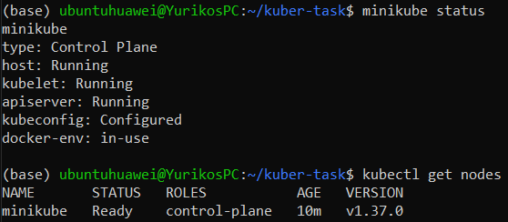

## 2. Deployments

Backend запущен в 3 репликах, frontend в 1.

```bash
kubectl get deployments
```

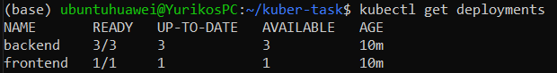

## 3. Поды

```bash
kubectl get pods -o wide
```

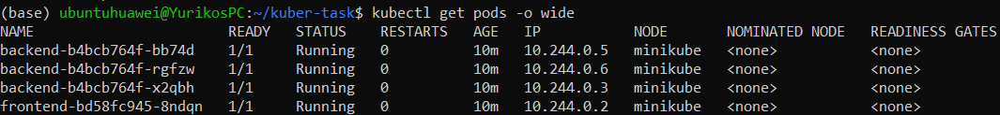

## 4. Сервисы

`backend-service` имеет тип ClusterIP (внутренний), `frontend-service` тип LoadBalancer с внешним IP.

```bash
kubectl get svc -o wide
```

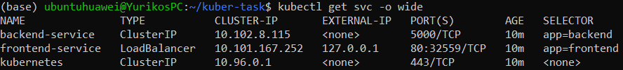

## 5. Запрос к frontend по внешнему IP

Frontend доступен снаружи, запрос доходит до backend, в ответе имя пода.

```bash
EXTERNAL_IP=$(kubectl get svc frontend-service -o jsonpath='{.status.loadBalancer.ingress[0].ip}')
curl -i http://$EXTERNAL_IP/
```

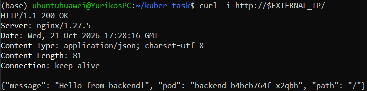

## 6. Балансировка между репликами

15 запросов обработаны разными подами backend.

```bash
for i in $(seq 1 15); do curl -s http://$EXTERNAL_IP/ | grep -o '"pod": "[^"]*"'; done | sort | uniq -c
```

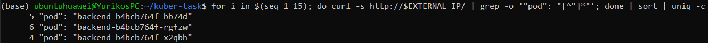

## 7. Backend доступен внутри кластера

Запрос из временного пода по DNS-имени сервиса.

```bash
kubectl run tmp --rm -it --image=busybox --restart=Never -- wget -qO- http://backend-service:5000/
```

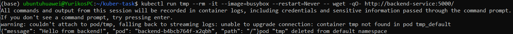

## 8. Backend недоступен снаружи

У `backend-service` нет внешнего IP (`EXTERNAL-IP: <none>`).

```bash
kubectl get svc backend-service
```

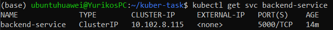

## 9. Самовосстановление

После удаления пода Deployment создаёт новый, число реплик возвращается к 3.

```bash
kubectl delete pod <имя-пода-backend>
kubectl get pods -l app=backend
```

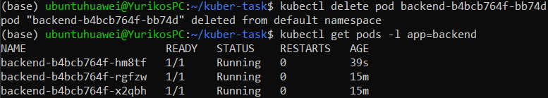

## 10. Масштабирование

```bash
kubectl scale deployment backend --replicas=5
kubectl get pods -l app=backend
```

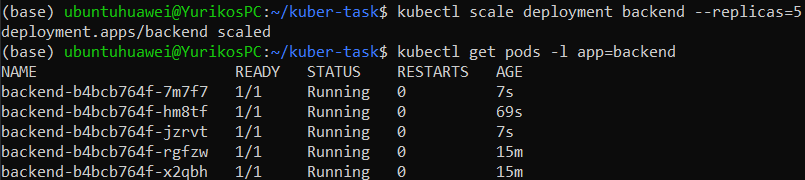

## 11. Автоматическая проверка

Скрипт `check.sh`: `Y` значит проверка пройдена, `N` не пройдена.

```bash
./check.sh
```

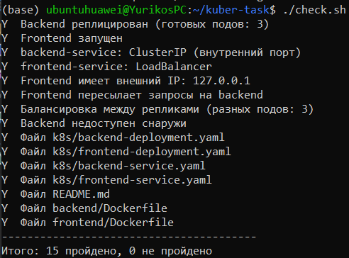

---

## Вывод

Все требования задания выполнены:

- Backend слушает внутренний порт, отвечает на запросы и реплицирован (3 пода).
- Frontend принимает внешние запросы и пересылает их на backend.
- Frontend имеет IP-адрес, доступный вне кластера (LoadBalancer).
- Балансировка между репликами и самовосстановление работают, backend снаружи недоступен.
